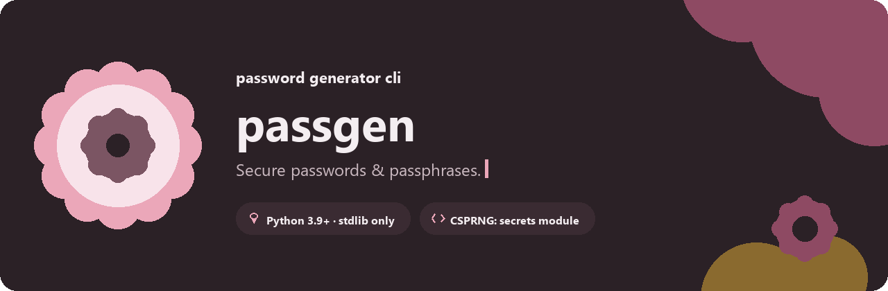
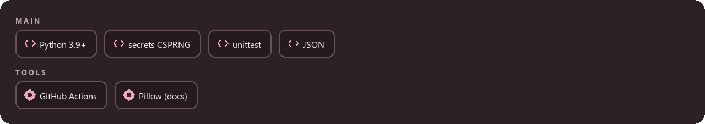
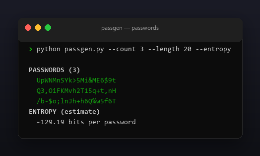
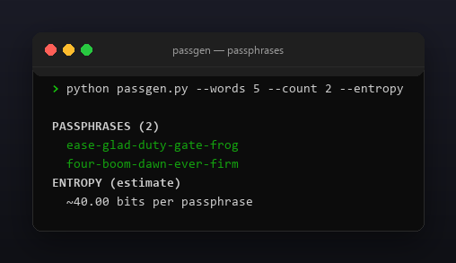

<p align="center"></p>

<p align="center">
  <a href="README.ru.md"></a>
  <a href="https://github.com/Celine1337/passgen/releases"></a>
  <a href="https://github.com/Celine1337/passgen/actions/workflows/ci.yml"></a>
  <a href="LICENSE"></a>
</p>


Generator of passwords and passphrases where every random choice comes from
the `secrets` module — the operating system's CSPRNG, not a seeded
pseudo-random generator. Weak, predictable passwords are the classic way
accounts get taken over; passgen makes the strong choice the easy one:

- random passwords from lower + upper + digits + symbols, with per-class
  toggles and an ambiguous-character filter;
- passphrases built from an embedded 256-word list of common, easy-to-read
  words, joined by a separator of your choice;
- an estimated entropy readout so you can see what a setting buys you.

Single file, standard library only, Python 3.9+, no network. Results are
printed to stdout and never written to disk.


- CSPRNG everywhere: `secrets.choice` for characters and words, a
  `secrets.SystemRandom` shuffle for positions.
- Guarantees at least one character from each enabled class when the length
  permits, then shuffles so the guaranteed positions are not predictable.
- `--exclude-ambiguous` drops the look-alikes `I l 1 O 0`.
- Passphrase mode: `--words N` with `--separator` (default `-`); the wordlist
  is embedded, so it works fully offline.
- `--entropy` prints estimated bits; `--json` emits
  `{passwords: [...], entropy_bits: ...}` for scripts.
- Colored ANSI output, `--no-color` and `NO_COLOR`.

| Flag | Default | Meaning |
|------|---------|---------|
| `--length N` | `16` | password length (ignored in `--words` mode) |
| `--count N` | `1` | how many passwords / passphrases to generate |
| `--no-symbols` | off | disable the symbol class |
| `--no-digits` | off | disable the digit class |
| `--no-upper` | off | disable the uppercase class |
| `--no-lower` | off | disable the lowercase class |
| `--exclude-ambiguous` | off | remove look-alike characters `I l 1 O 0` |
| `--words N` | off | passphrase mode: N words from the embedded list |
| `--separator STR` | `-` | passphrase separator (empty string allowed) |
| `--entropy` | off | print estimated entropy bits |
| `--json` | off | machine-readable `{passwords, entropy_bits}` |
| `--no-color` | off | disable ANSI colors (also honors `NO_COLOR`) |
| `--version` | — | print `passgen 1.0.0` |


Impossible inputs are rejected up front with exit code `2` and a message on
stderr — nothing is generated:

| Input | Result |
|-------|--------|
| `--length` < 1 | exit 2 |
| `--count` < 1 | exit 2 |
| `--words` < 1 | exit 2 |
| all four character classes disabled | exit 2 |
| non-numeric value for `N` | exit 2 (argparse) |

Exit codes: `0` — success, `1` — reserved, `2` — bad input.

Honest limits: the entropy figure is an **estimate**. For passwords it is
`length * log2(charset_size)`, which assumes uniform independent draws; the
one-per-class guarantee biases the distribution slightly, so true entropy is
a little lower. For passphrases it is `words * log2(256)` = 8 bits per word,
which is exact for uniform independent picks (repeats allowed). The wordlist
is public and embedded — strength comes from the random selection, not from
secrecy of the list. And like any generator, passgen cannot protect you from
shoulder surfing or terminal scrollback: it prints secrets to stdout only.





```console
$ python passgen.py                            # one 16-char password
$ python passgen.py --length 24 --count 3 --entropy
$ python passgen.py --no-symbols --exclude-ambiguous
$ python passgen.py --words 5 --separator .
$ python passgen.py --words 4 --json
```

Example output (every run is different; these are throwaway samples):

```
PASSWORDS (3)
  }QLND4Gpa[i9eqSqg%7PBY-m
  2U>,szJh3b1g-Q?O9Jd{^opR
  D4}g2-&[1e=Rz{W]m>lb6*b&
ENTROPY (estimate)
  ~155.03 bits per password
```

```
PASSPHRASES (1)
  fund-just-five-grew-blue
ENTROPY (estimate)
  ~40.00 bits per passphrase
```







```console
$ python -m unittest discover -s tests -v
```

45 tests cover charset toggles, the per-class guarantee, ambiguous filtering,
passphrase mode, entropy math, JSON shape, colors and every exit code. All
images are regenerable offline:

```console
$ pip install pillow
$ python tools/make_shots.py      # docs/passwords.png, docs/passphrase.png
$ python tools/make_style.py tools/style.json docs/style
```


[MIT](LICENSE) © Celine1337