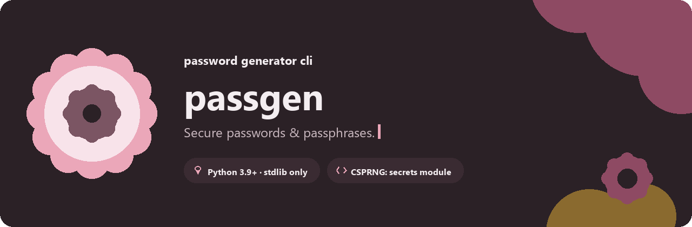
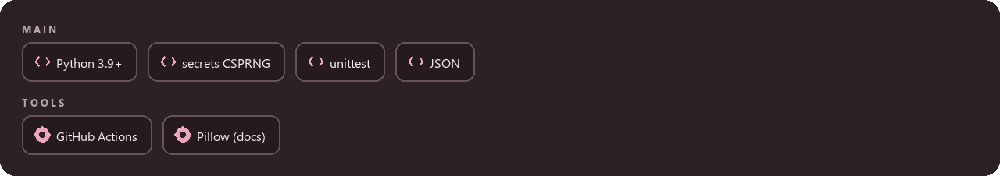
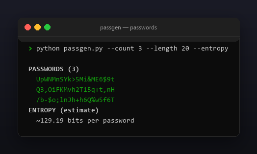
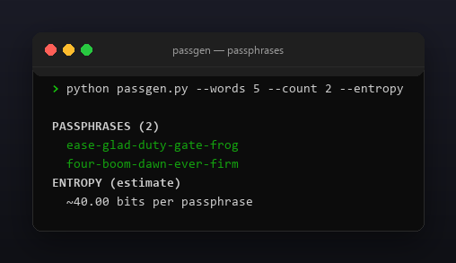

<p align="center"></p>

<p align="center">
  <a href="README.md"></a>
  <a href="https://github.com/Celine1337/passgen/releases"></a>
  <a href="https://github.com/Celine1337/passgen/actions/workflows/ci.yml"></a>
  <a href="LICENSE"></a>
</p>


Генератор паролей и парольных фраз, в котором каждый случайный выбор делает
модуль `secrets` — CSPRNG операционной системы, а не seeded псевдослучайный
генератор. Слабые предсказуемые пароли — классический путь к угону аккаунта;
passgen делает сильный выбор простым:

- случайные пароли из lower + upper + digits + symbols с переключателями
  классов и фильтром неоднозначных символов;
- парольные фразы из встроенного списка из 256 простых читаемых слов,
  соединённых разделителем на ваш выбор;
- оценка энтропии в битах, чтобы видеть, что даёт каждая настройка.

Один файл, только стандартная библиотека, Python 3.9+, без сети. Результат
печатается в stdout и никогда не пишется на диск.


- CSPRNG везде: `secrets.choice` для символов и слов, перемешивание позиций
  через `secrets.SystemRandom`.
- Гарантия хотя бы одного символа каждого включённого класса, когда длина
  позволяет; затем перемешивание, чтобы позиции гарантий не были предсказуемы.
- `--exclude-ambiguous` убирает похожие символы `I l 1 O 0`.
- Режим фраз: `--words N` с `--separator` (по умолчанию `-`); список слов
  встроен, поэтому всё работает полностью офлайн.
- `--entropy` печатает оценку в битах; `--json` выдаёт
  `{passwords: [...], entropy_bits: ...}` для скриптов.
- Цветной ANSI-вывод, `--no-color` и `NO_COLOR`.

| Флаг | По умолчанию | Смысл |
|------|--------------|-------|
| `--length N` | `16` | длина пароля (игнорируется в режиме `--words`) |
| `--count N` | `1` | сколько паролей / фраз сгенерировать |
| `--no-symbols` | выкл | отключить класс символов |
| `--no-digits` | выкл | отключить класс цифр |
| `--no-upper` | выкл | отключить верхний регистр |
| `--no-lower` | выкл | отключить нижний регистр |
| `--exclude-ambiguous` | выкл | убрать похожие символы `I l 1 O 0` |
| `--words N` | выкл | режим фраз: N слов из встроенного списка |
| `--separator STR` | `-` | разделитель фразы (пустая строка допускается) |
| `--entropy` | выкл | печатать оценку энтропии в битах |
| `--json` | выкл | машинный вывод `{passwords, entropy_bits}` |
| `--no-color` | выкл | отключить ANSI-цвета (также уважает `NO_COLOR`) |
| `--version` | — | печатает `passgen 1.0.0` |


Невозможные комбинации отклоняются сразу: код возврата `2` и сообщение в
stderr — ничего не генерируется:

| Вход | Результат |
|------|-----------|
| `--length` < 1 | код 2 |
| `--count` < 1 | код 2 |
| `--words` < 1 | код 2 |
| все четыре класса символов отключены | код 2 |
| нечисловое значение `N` | код 2 (argparse) |

Коды возврата: `0` — успех, `1` — зарезервирован, `2` — неверный ввод.

Честные ограничения: энтропия — **оценка**. Для паролей это
`length * log2(charset_size)`, что предполагает равномерные независимые
выборы; гарантия «по одному символу класса» слегка смещает распределение,
поэтому реальная энтропия чуть ниже. Для фраз это `words * log2(256)` = 8 бит
на слово, точно для равномерных независимых выборов (повторы допускаются).
Список слов публичный и встроенный — сила в случайном выборе, а не в
секретности списка. И как любой генератор, passgen не защитит от подглядывания
через плечо или истории терминала: секреты печатаются только в stdout.





```console
$ python passgen.py                            # один пароль из 16 символов
$ python passgen.py --length 24 --count 3 --entropy
$ python passgen.py --no-symbols --exclude-ambiguous
$ python passgen.py --words 5 --separator .
$ python passgen.py --words 4 --json
```

Пример вывода (каждый запуск другой; это одноразовые образцы):

```
PASSWORDS (3)
  }QLND4Gpa[i9eqSqg%7PBY-m
  2U>,szJh3b1g-Q?O9Jd{^opR
  D4}g2-&[1e=Rz{W]m>lb6*b&
ENTROPY (estimate)
  ~155.03 bits per password
```

```
PASSPHRASES (1)
  fund-just-five-grew-blue
ENTROPY (estimate)
  ~40.00 bits per passphrase
```







```console
$ python -m unittest discover -s tests -v
```

45 тестов покрывают переключатели классов, гарантию по классам, фильтр
неоднозначных символов, режим фраз, математику энтропии, форму JSON, цвета и
все коды возврата. Все картинки перегенерируются офлайн:

```console
$ pip install pillow
$ python tools/make_shots.py      # docs/passwords.png, docs/passphrase.png
$ python tools/make_style.py tools/style.json docs/style
```


[MIT](LICENSE) © Celine1337